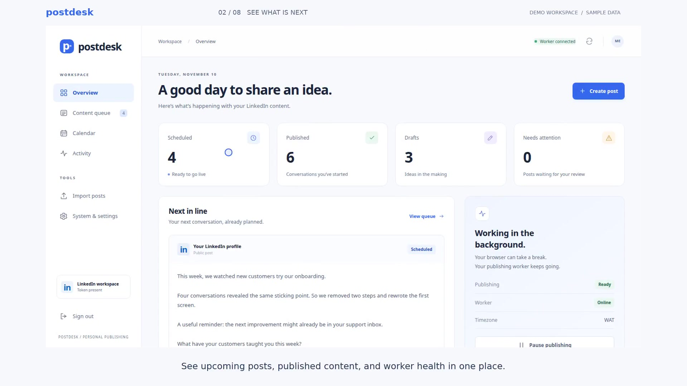
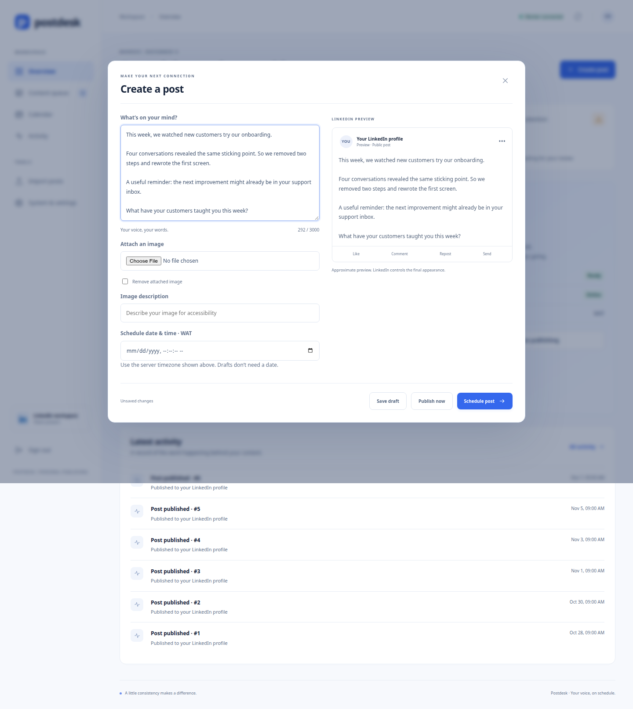

# Postdesk · LinkedIn Autoposter

[](LICENSE)
[](https://www.python.org/)

**Plan your content. Schedule your posts. Keep publishing while your browser is closed.**

Postdesk is a self-hosted, single-owner LinkedIn publishing workspace. It pairs a responsive HTML/CSS/JavaScript dashboard with a separate Python worker, so managing your content and publishing it do not depend on keeping a browser tab open.

[](https://github.com/sammiykay/linkedin-autoposter/raw/refs/heads/main/docs/postdesk-demo.mp4)

**[▶ Watch the 60-second walkthrough](https://github.com/sammiykay/linkedin-autoposter/raw/refs/heads/main/docs/postdesk-demo.mp4)** · Captioned · 1080p · MP4 (1.7 MB)

See a post go from the composer and live preview to the scheduled queue, calendar, and background-worker status. Click the preview to open the video; GitHub READMEs do not support video autoplay.

*Illustrative demo workspace with sample posts and simulated connection health. Publishing counts are sample data, not live account activity or engagement analytics.*

[Quick start](#quick-start-linux) · [Features](#features) · [Email alerts](#email-alerts-with-resend) · [Operations guide](docs/OPERATIONS.md) · [API reference](docs/API.md) · [License](LICENSE)

## Features

| Workflow | What you can do |
| --- | --- |
| Compose | Save drafts, preview posts, attach images, and add accessible image descriptions. |
| Schedule | Pick a publishing time, browse a monthly calendar, and manage a searchable, paginated queue. |
| Import | Upload CSV or Excel files with up to 500 posts, with validation and duplicate-file confirmation. |
| Publish | Send text and image posts through the official LinkedIn member APIs using a separate background worker. |
| Recover | Review failed or uncertain publications; pause and resume without losing your queue. |
| Monitor | Inspect worker health, token status, audit history, backup results, and email delivery attempts. |
| Run unattended | Install systemd services with boot startup, automatic process restart, daily backups, and independent monitoring. |

Each dashboard page has its own skeleton layout during initial loading. Cached pages remain visible during background refreshes, while saves and imports show action-specific progress. Loading states support keyboard users and reduced-motion preferences.

The app publishes to the **authorized member’s profile**. Company-page publishing, multi-user accounts, engagement analytics, and automatic image generation are not implemented. Images are currently attached through the composer; uploading them to LinkedIn is automatic when the post publishes.

## Leads and follow-ups

Use the separate **Leads** workspace to import CSV/Excel contacts, organize campaigns, personalize message drafts, and schedule daily or weekly worklists. Send each message yourself on LinkedIn, then mark it sent in Postdesk. Record replies to stop follow-ups. Optional Resend digests remind you about due work; configurable buyer criteria explain each profile-fit score.

**This is assisted outreach:** Postdesk does not automatically send LinkedIn messages or read replies. Scoring uses transparent rules, not a trained model. [Templates, spreadsheet format, campaign setup, and reminders →](docs/LEADS.md)

## Requirements

- **Python 3.12 or newer**, including its `venv` module.
- **Linux with systemd, sudo, and `flock`** for unattended operation. Run the installer from a normal user account using sudo, rather than logging in as root.
- A LinkedIn developer application with the products and permissions needed for member posting and OpenID Connect sign-in.
- A browser for the dashboard and initial LinkedIn authorization; internet access for installation and publishing.
- Optional: a Resend account and verified sending domain for email alerts.

The pinned dependencies were verified on Python 3.12/Linux. A temporary Windows launcher is included, but the provided boot-startup and backup deployment targets Linux.

**The host must be awake and online to publish.** Boot startup resumes the services after a restart; it cannot publish while a computer is powered off or asleep. Use an always-on Linux host if you need publishing independent of your personal computer.

## Quick start (Linux)

### 1. Clone and configure

```bash
git clone https://github.com/sammiykay/linkedin-autoposter.git
cd linkedin-autoposter
cp .env.example .env
chmod 600 .env
```

Edit `.env` in your preferred editor. At minimum, configure:

```dotenv
APP_PASSWORD=replace-with-a-unique-password-at-least-12-characters
LINKEDIN_CLIENT_ID=your_client_id
LINKEDIN_CLIENT_SECRET=your_client_secret
LINKEDIN_REDIRECT_URI=http://localhost:8000/callback
```

Keep the other defaults initially. Email settings can remain empty; publishing does not require email delivery. Never commit `.env`, OAuth tokens, or API keys. Only copy `.env.example` on first setup—do not overwrite an existing configuration during upgrades.

### 2. Configure your LinkedIn application

In the [LinkedIn Developer Portal](https://www.linkedin.com/developers/apps):

1. Create or select your application and complete LinkedIn’s application requirements.
2. Enable **Share on LinkedIn** and **Sign In with LinkedIn using OpenID Connect**, obtaining the required access for your application.
3. Register `http://localhost:8000/callback` as a redirect URL, matching `.env` exactly.
4. Copy the client ID and client secret into your private `.env`.

The application requests `openid profile w_member_social`. Your LinkedIn app must actually have access to these scopes; configuring their names locally does not grant that access.

### 3. Install background services

```bash
sudo bash deploy/install.sh
```

The installer creates an isolated release and virtual environment, installs pinned dependencies, runs tests, installs services and timers, and verifies dashboard and worker readiness. You do not need to create a top-level virtual environment for this installation method.

It enables these units:

| Unit | Purpose |
| --- | --- |
| `autoposter-dashboard.service` | Dashboard and authenticated API, bound to localhost. |
| `autoposter-worker.service` | Scheduled publishing and persistent queue recovery. |
| `autoposter-backup.timer` | Daily content backups, normally around 03:00. |
| `autoposter-monitor.timer` | Independent health checks approximately every five minutes. |

On a new installation, the worker waits for valid authorization. **On an upgrade, eligible due posts can publish after activation unless you paused publishing beforehand.**

### 4. Authorize LinkedIn

From the project directory, as your normal user:

```bash
current/venv/bin/python -m app.auth
```

Complete authorization in the browser. The token is stored privately in `data/token.json`. Reauthorize when the dashboard warns about expiry. Renewing authorization clears the authorization block after validation; it does not clear a manual pause.

On a remote host, the OAuth browser callback must reach the machine running this command. For the default callback, forward port 8000 with `ssh -L 8000:127.0.0.1:8000 user@your-server`, run the command on that server, and open its printed authorization URL in your local browser.

### 5. Open your workspace

Visit **http://127.0.0.1:8501** and sign in using `APP_PASSWORD`.

Create a draft, review the preview, then choose a future schedule or explicitly select **Publish now**. Verify your first intended post on LinkedIn before relying on unattended publishing.

Check services at any time:

```bash
systemctl status autoposter-worker autoposter-dashboard --no-pager
systemctl list-timers autoposter-backup.timer autoposter-monitor.timer
```

After a reboot, confirm both services are active and the dashboard shows a fresh worker heartbeat. Closing the terminal or browser does not stop installed services.

## Creating and importing posts



- Text: up to **3,000 characters** per post.
- Images: **JPG, PNG, or GIF**, up to **8 MB**, with optional alt text. The application also limits decoded image dimensions.
- Imports: **CSV or XLSX**, up to **500 rows** and a **20 MB request size**. All rows are validated before any are inserted.
- Published and publishing posts are read-only. Pending posts can be edited or deleted.

A minimal CSV for drafts:

```csv
text,scheduled_at,alt_text
"An idea to refine later",,
"Another conversation worth starting",,
```

The `text` column is required. For a scheduled post, set `scheduled_at` to a **future date** in `YYYY-MM-DD HH:MM:SS` format. Blank schedules create drafts. Optional `alt_text` describes an image; attach the image itself through the composer after importing.

**Schedules use the server’s local timezone**, shown in the dashboard. There is no per-post timezone conversion. Keep the host timezone consistent after scheduling, and update example dates before importing them. Identical files imported again within 24 hours require explicit confirmation.

## Email alerts with Resend

Alerts are optional. [Verify your sending domain in Resend](https://resend.com/docs/dashboard/domains/introduction), create a sending API key, and set:

```dotenv
EMAIL_PROVIDER=resend
RESEND_API_KEY=re_your_private_key
RESEND_FROM="Postdesk <alerts@your-verified-domain.com>"
ALERT_TO=you@example.com
```

Use one recipient address in `ALERT_TO`. After changing settings, restart the dashboard and worker; each monitoring job reads settings at startup:

```bash
sudo systemctl restart autoposter-worker autoposter-dashboard
current/venv/bin/python -m app.alerts status
# Explicitly send yourself one test alert:
current/venv/bin/python -m app.alerts test
```

The System page shows missing configuration, pending retries, sanitized errors, and provider acceptance receipts. Acceptance does not guarantee inbox delivery. SMTP is also available by choosing `EMAIL_PROVIDER=smtp`; see the [email operations guide](docs/OPERATIONS.md#monitoring-and-email).

## Updates, backups, and recovery

Pause publishing in the dashboard before applying an update if you want to prevent due posts from firing after activation.

```bash
git pull --ff-only
sudo bash deploy/install.sh
```

The installer prepares and tests a new release before switching services, takes a pre-migration snapshot, and retains the previous managed release. For rollback:

```bash
sudo bash deploy/rollback.sh
current/venv/bin/python -m app.manage recover-deployment
```

Recovery leaves publishing manually paused so you can review the queue before resuming. The first managed installation has no previous release; its snapshot is available for manual recovery.

Create a content backup manually:

```bash
bash deploy/backup.sh
```

Successful snapshots contain the database, referenced images, and a checksum manifest; retention is 14 days. **Backups are local and exclude credentials.** Copy snapshots and separately protected credentials off-device if you need recovery after loss of the host.

For restore instructions, failure handling, remote HTTPS access, and uninstall commands, see the [operations guide](docs/OPERATIONS.md).

## Troubleshooting

| Symptom | What to check |
| --- | --- |
| No posts publish | Check worker status, manual pause, authorization blocking, deployment blocking, and scheduled times. |
| Worker is already running | Stop a manually launched worker before starting the service. Do not run both modes together. |
| LinkedIn returns HTTP 426 | Update `LINKEDIN_VERSION` in `.env` to a version listed in [LinkedIn’s version documentation](https://learn.microsoft.com/en-us/linkedin/marketing/versioning), then restart services and explicitly reschedule the failed post. |
| LinkedIn returns HTTP 401 | Reauthorize with `current/venv/bin/python -m app.auth`, then check connection status. |
| A post is `uncertain` | Check your LinkedIn profile before resolving it. The publication may have succeeded despite the missing response. Never blindly retry. |
| A post is `missed` | It exceeded the configured overdue grace window. Review it and choose a new schedule. |
| Email alerts are not configured | Supply the selected provider’s settings in `.env`; inspect System for the missing variable names. |
| Dashboard cannot be reached remotely | It binds to localhost. Use an SSH tunnel; see below. |

```bash
journalctl -u autoposter-worker -f
journalctl -u autoposter-dashboard -n 50 --no-pager
curl -f http://127.0.0.1:8501/healthz
```

`/healthz` checks the dashboard and database, not publishing capability. Check the worker heartbeat and authorization separately.

For remote dashboard access:

```bash
ssh -L 8501:127.0.0.1:8501 user@your-server
```

Then visit http://127.0.0.1:8501 locally. For domain access, configure TLS with the [nginx example](deploy/nginx.conf.example) and enable `COOKIE_SECURE=true` when using HTTPS. Leave it false for local HTTP and SSH tunnels.

## Development and tests

Create a separate environment when working on the source:

```bash
python3 -m venv venv
venv/bin/pip install -r requirements.lock
venv/bin/python -m pytest -q tests
```

Tests use isolated storage and mocked external requests; they do not publish real LinkedIn posts or send real email. Optional browser checks use a temporary local server:

```bash
venv/bin/pip install -r requirements-dev.txt
venv/bin/python tests/browser_smoke.py
venv/bin/python tests/loading_smoke.py
```

To regenerate the documentation screenshots with realistic sample posts and simulated connection health, run `venv/bin/python scripts/capture_previews.py`. It uses temporary storage and never publishes to LinkedIn.

The browser script uses `/usr/bin/google-chrome` when available. Set `CHROME_BIN` to another Chromium executable or install Playwright Chromium with `venv/bin/playwright install chromium`.

For a temporary interactive run, configure `.env`, authorize using `venv/bin/python -m app.auth`, then run `bash run_local.sh`. This starts a **real worker** and runs only while the session remains open. Never run it alongside installed services. `run_local.bat` provides a temporary Windows launcher; there is no Windows boot-service installer.

The stack is Flask + Waitress, SQLite with WAL, vanilla HTML/CSS/JavaScript, and Python workers. See the [API reference](docs/API.md) for authentication, idempotency, pagination, and recovery endpoints.

## Reliability and security notes

The app uses revocable sessions, persistent sign-in throttling, CSRF protection, private credential files, an OS worker lock, transactional queue claims, and an audit history. Publishing uses recorded attempt phases and conservative recovery rather than claiming exactly-once delivery.

Posts can be overdue after downtime. Those within `MISSED_AFTER_HOURS` (default 24) may publish after recovery; older ones become missed. Network failures can make publication uncertain, and external API permissions, versions, and tokens require maintenance.

Keep runtime files private, review ambiguous outcomes before retrying, and verify your own deployment’s backup restoration, email delivery, and reboot behavior. The dashboard is a single-owner tool; it is not a multi-tenant hosted service.

## Contributing

Issues and pull requests are welcome. Describe the problem, reproduction steps, and expected behavior, and run the relevant tests before submitting changes. Keep credentials, OAuth tokens, post databases, and private media out of commits and issue reports.

## License

[MIT](LICENSE) © 2026 Oke Samson.
